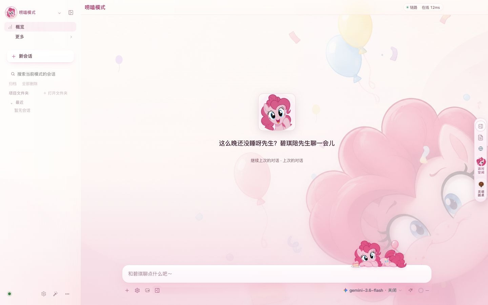
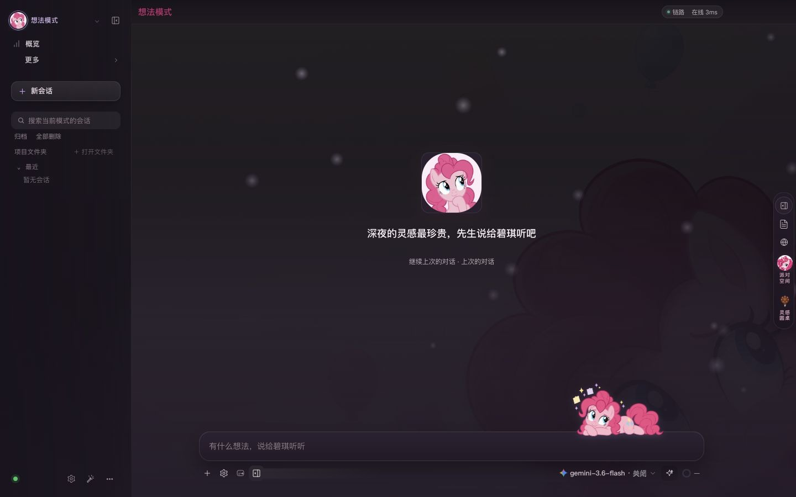
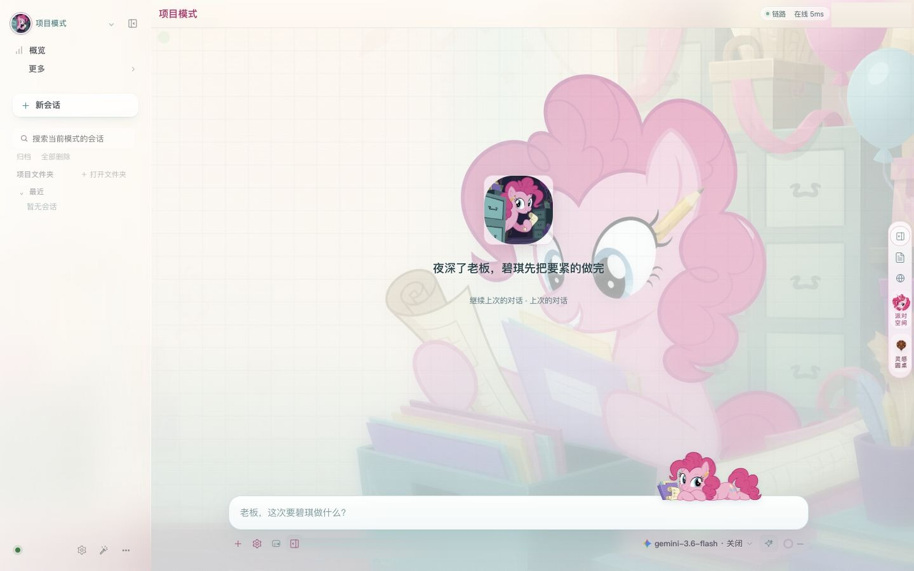
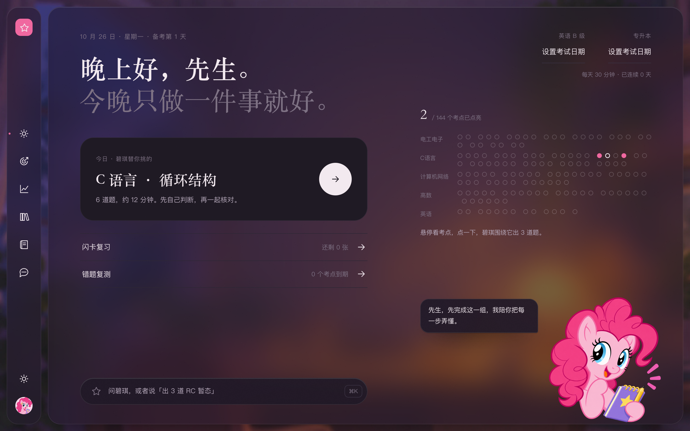
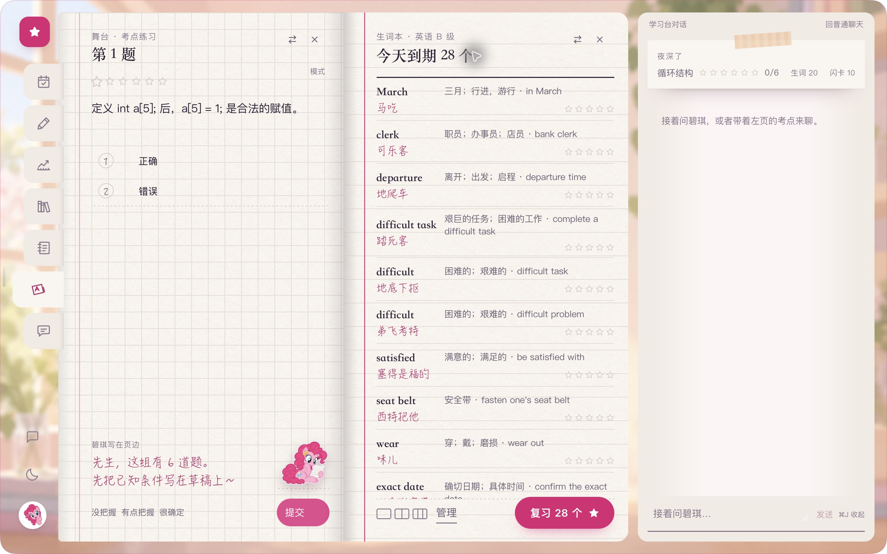
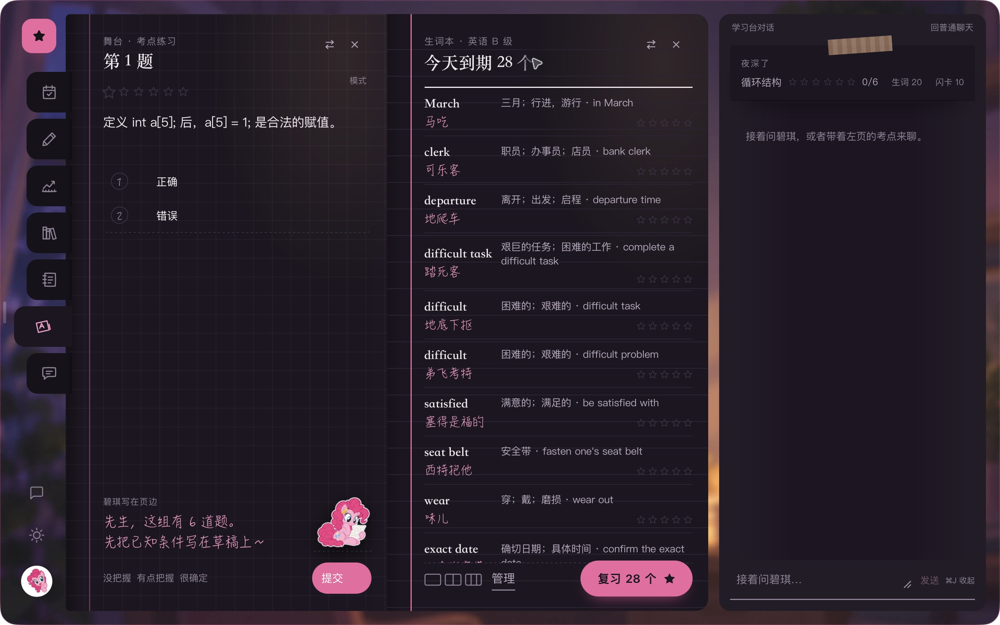
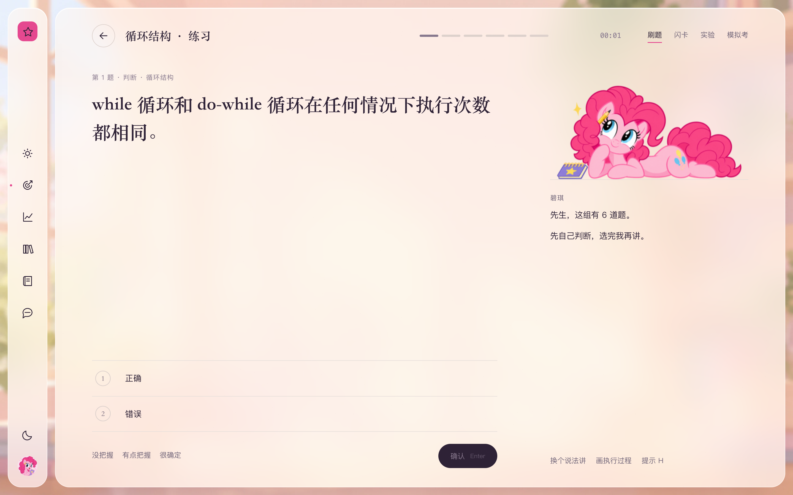
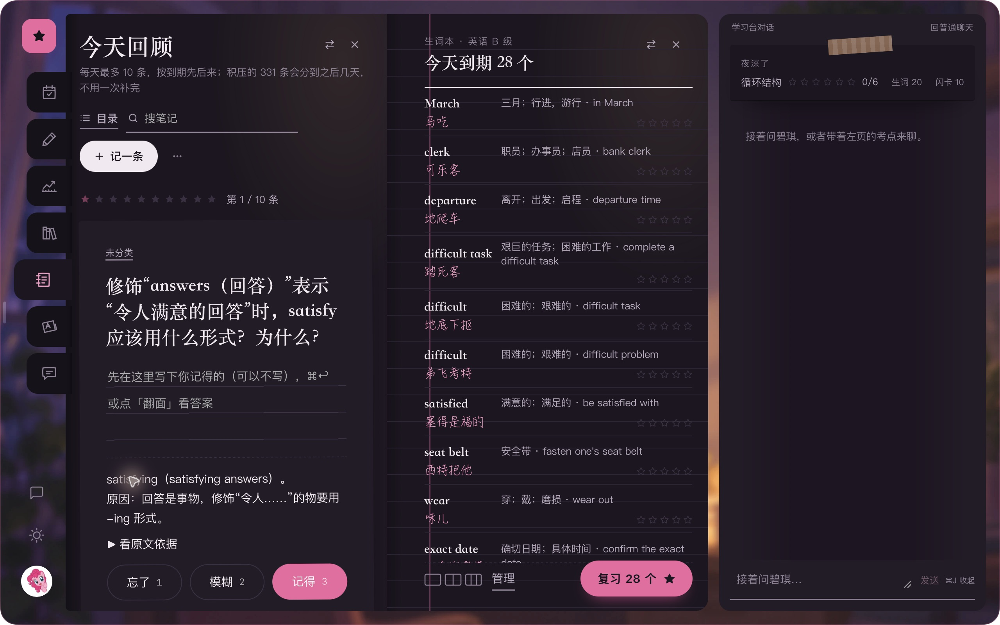
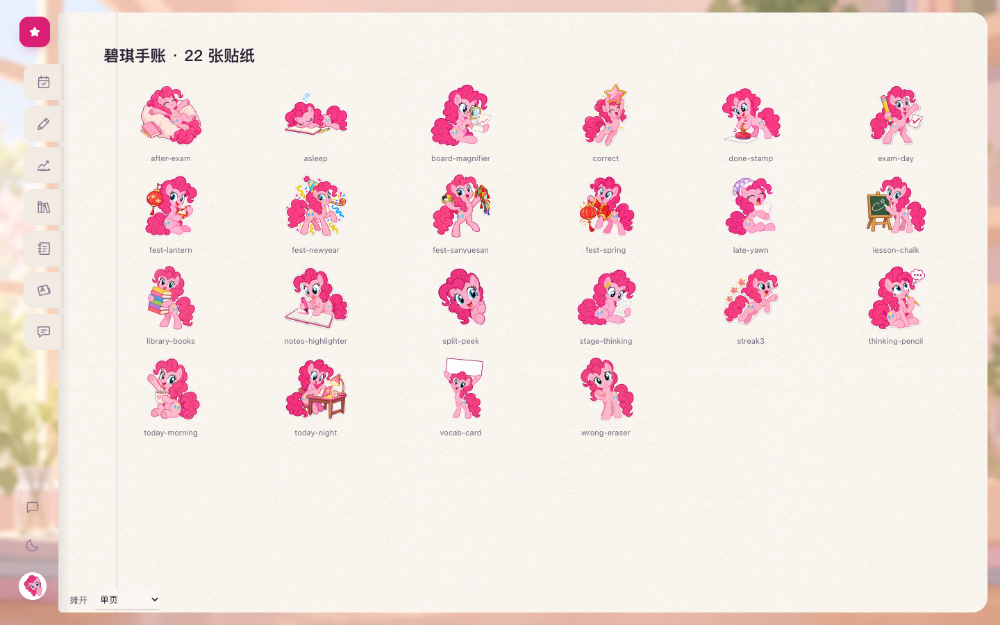

<p align="center">
  
</p>

<h1 align="center">超級碧琪 🎈 (Super Pinkie)</h1>

<p align="center">
  <strong>一间透明粉色玻璃质感的桌面工作室 · 五种模式里陪你把事做成的碧琪</strong><br>
  支持 <strong>macOS</strong> 与 <strong>Windows 10/11</strong> 原生无边框桌面窗口 · 双击即用 · 在线拉取更新
</p>

<p align="center">
  <a href="#五大专属模式">五大模式</a> ·
  <a href="#学习书桌-v2">学习书桌 v2</a> ·
  <a href="#工作台与多角色空间">派对空间与灵感圆桌</a> ·
  <a href="#windows-快速使用">Windows 安装</a> ·
  <a href="#macos-快速使用">macOS 安装</a> ·
  <a href="#项目结构">项目结构</a>
</p>

---

**超級碧琪**是一套完整的桌面 AI 工作室与伴侣系统：白天是通透柔和的糖果粉毛玻璃桌面，夜里是安静护眼的深色书房。住在这里的**碧琪**不仅能陪你日常唠嗑，还拥有独立的**项目工作台**、**深度推演空间**与**双页手账学习书桌**——从写代码、跑 `.ipynb` 笔记本、多角色圆桌头脑风暴，到考纲闯关、错题复盘与生词记忆，都在同一个原生桌面窗口里完成。

<table>
  <tr>
    <td width="50%">
      
      <p align="center"><sub>日间界面 · 透明毛玻璃窗口与趴在输入框上的小碧琪</sub></p>
    </td>
    <td width="50%">
      
      <p align="center"><sub>夜间界面 · 深色护眼主题与多档位深度思考</sub></p>
    </td>
  </tr>
</table>

---

## 五大专属模式

五个模式拥有**各自独立的会话列表、记忆上下文、视觉调色盘与原画转场**，切换时互不串味，每个模式的碧琪都有专门打磨的工作手册（`personas/`）：

| 模式插画 | 模式名称 | 角色定位与交互特点 |
| :---: | :--- | :--- |
|  | **唠嗑模式**<br>`Chat` | **日常陪伴与随手问答**<br>称呼你为「先生」，语气鲜活自然、有观察有笑点；适合日常闲聊、快速查资料、语音对讲与生活记录。 |
|  | **项目模式**<br>`Project` | **工程交付与代码工作台**<br>认真干活的碧琪，专称「老板」；左侧直接绑定本地项目文件夹，支持代码编辑、`.ipynb` 笔记本内核执行、终端命令与成品文件一键预览。 |
|  | **想法模式**<br>`Thinking` | **方案推演与审美设计**<br>配备灵感气泡动效、多档深度推理与审美规范（`AESTHETICS.md`），适合架构推演、产品设计、长文撰稿与复杂决策拆解。 |
|  | **学习模式**<br>`Learning` | **备考手账与随堂私教**<br>温柔但对错毫不含糊的碧琪老师；内置 **学习书桌 v2**，把今日计划、144 考纲关卡、互动讲义、双页错题本与生词手账摊开在同一张桌面上。 |
|  | **无限制模式**<br>`Unrestricted` | **自由探索与高阶测试**<br>零预设条框束缚，配合本地 HTTP 注入代理与双传输层补丁，按模型自动路由提示词策略。 |

<p align="center">
  
  <br>
  <sub>项目模式 · 独立目录绑定、专属「老板」工作口吻与右侧快捷工具栏</sub>
</p>

---

## 学习书桌 v2

在**学习模式**下，碧琪为你准备了一张仿真手账质感的双页学习书桌，涵盖**今日看板、讲义、练习、生词、资料库与笔记本**六大模块：

### 1. 今日看板与 144 考纲关卡地图（昼夜双主题）

- **考纲闯关路线图**：内置英语、计算机基础与 C 语言程序设计共 **144 个考纲关卡**，实时统计已掌握、进行中与待复习节点。
- **今日三件事 & 碧琪陪学卡**：自动汇总逾期复习、错题回炉与新课推荐，点击「交给碧琪安排」即可直接进入互动教学。

<table>
  <tr>
    <td width="50%">
      
      <p align="center"><sub>学习书桌 · 日间纸张质感与 144 考纲关卡地图</sub></p>
    </td>
    <td width="50%">
      
      <p align="center"><sub>学习书桌 · 夜间深色模式</sub></p>
    </td>
  </tr>
</table>

### 2. 双页手账摊开：左页刷题批注 + 右页生词手账 + 随堂问答

- **双页横线纸手账**：左页展示考纲真题、解析与**碧琪手写批注便利贴**；右页同步展开高频生词本（音标、谐音助记、例句与掌握度标签）。
- **右侧伴学侧栏**：无需切出书桌，右侧直接与碧琪老师对话；说一句「出点题」「没懂」「换个讲法」，碧琪会自动读取当前书桌卡点开始讲解。

<table>
  <tr>
    <td width="50%">
      
      <p align="center"><sub>双页手账（日间）· 真题批注 + 生词手账 + 右侧碧琪伴学</sub></p>
    </td>
    <td width="50%">
      
      <p align="center"><sub>双页手账（夜间）· 深色纸张与暖色荧光笔高亮</sub></p>
    </td>
  </tr>
</table>

### 3. 互动做题舞台与主动回忆闪卡

- **随堂互动舞台**：针对 C 语言循环、条件分支与英语语法提供分步互动题卡，答错直说错因，答对即时记录掌握度。
- **主动回忆（Active Recall）**：一键遮挡笔记关键结论进行自测翻卡，根据「稳了 / 有点卡 / 没想起来」动态调整复习间隔。

<table>
  <tr>
    <td width="50%">
      
      <p align="center"><sub>随堂练习舞台 · C 语言代码追踪与碧琪实时辅导</sub></p>
    </td>
    <td width="50%">
      
      <p align="center"><sub>笔记主动回忆 · 翻卡自测与掌握度评分</sub></p>
    </td>
  </tr>
</table>

### 4. 22 枚碧琪手绘手账贴纸

书桌内置 **22 枚原创手绘碧琪手账贴纸**（晨读、夜习、连胜打卡、重点放大镜、满分印章、错题橡皮擦、考前冲刺与节日彩蛋等），随学习进度与节气自动装点手账页面：

<p align="center">
  
</p>

---

## 工作台与多角色空间

除了五种单人陪伴模式，右侧快捷栏还可以随时呼出**项目工作台**、**内置悬浮浏览器**、**派对空间**与**灵感圆桌**：

<table>
  <tr>
    <td width="50%">
      
      <p align="center"><strong>🎉 派对空间（Party Space）</strong><br><sub>碧琪担任主持与总控，协同 Codex 执行代码任务、调用 CLE Kk 进行文本咨询，公开派工并逐项核验交付物。</sub></p>
    </td>
    <td width="50%">
      
      <p align="center"><strong>🔮 灵感圆桌（Roundtable）</strong><br><sub>水晶工坊里的六角色圆桌讨论：从发散创意、工程可行性、用户体验到风险挑刺，多视角碰撞后由碧琪汇总成可执行方案。</sub></p>
    </td>
  </tr>
</table>

### 核心桌面特性一览

- **趴在输入框上的活体小碧琪**：会随状态切换歇着、打字、认真干活、开心撒花与打盹眨眼。
- **工作台 `.ipynb` 与代码执行**：支持直接打开并运行 Jupyter Notebook（`.ipynb`）单元格、查看图表输出、预览 Markdown / PDF / Office / 图片成品并一键另存。
- **碧琪模型匣与多档思考**：顶栏与输入区一键切换模型提供商与推理深度档位，实时显示链路延迟与上下文容量。
- **语音听写与晓伊朗读**：内置麦克风听写；仅在语音输入时自动使用晓伊声线朗读回复，长文自动提炼摘要朗读。
- **macOS & Windows 原生无边框窗口**：
  - **macOS**：基于原生 `WKWebView` 构建圆角毛玻璃窗口、原生文件夹选择器、QuickLook 文件预览与独立悬浮浏览器。
  - **Windows 10/11**：基于 `WebView2` 构建无边框桌面窗口，配备右上角自定义最小化/最大化/关闭按钮、专属拖拽把手、四边四角缩放与右侧工具栏防遮挡避让。

---

## Windows 快速使用

### 方式一：下载便携版 EXE（推荐，双击即用 🚀）

从 [GitHub Releases](../../releases) 下载并解压 `super-pinkie-windows-<版本>-portable.zip`，直接双击运行其中的 `超級碧琪\超級碧琪.exe`（无需另装 Node.js 或 Python）：

1. 启动时播放开屏动画，后台自动拉起内置网关与本机服务，就绪后直接进入内嵌桌面窗口。
2. 五大模式、学习书桌、项目工作台、派对空间、灵感圆桌、语音服务与网关看门狗全部内置在同一个应用中。
3. API Key、聊天记录、项目绑定与自定义人格保存在 `%USERPROFILE%\.openclaw` 用户目录，升级 EXE 不会覆盖个人数据。
4. 点击窗口右上角星光更新按钮（或运行 `update.ps1`）即可在线检查并拉取最新版本。

### 方式二：源码一键部署（开发者可选）

在 PowerShell（管理员权限）下运行：

```powershell
# 1. 克隆仓库
git clone https://github.com/Cle0726/super-pinkie.git
cd super-pinkie

# 2. 一键安装（自动配置提示词、传输层补丁、五模式人格、UI 皮肤与代理服务）
.\install.ps1 -Provider mm

# 3. 日常拉取最新代码并重装皮肤与补丁（保留个人记忆与配置）
.\update.ps1

# 4. 若希望连同仓库最新人格模板一起覆盖同步
.\update.ps1 -SyncPersonas

# 5. 本机打包独立 Windows 桌面端 (.exe)
.\build-win.ps1
```

详细 Windows 部署说明参见 [docs/WINDOWS.md](docs/WINDOWS.md)。

---

## macOS 快速使用

### 一键安装完整桌面版 App

```bash
git clone https://github.com/Cle0726/super-pinkie.git
cd super-pinkie
./install-full.sh --provider mm
```

也可以使用单行命令自动完成克隆与安装：

```bash
curl -fsSL https://raw.githubusercontent.com/Cle0726/super-pinkie/main/bootstrap.sh | bash
```

> 安装器会自动备份已有的 `SOUL.md` 与 `IDENTITY.md`，绝不覆盖你的 `USER.md`、`TOOLS.md`、个人记忆与历史会话。

### 在线拉取更新

在 App 菜单栏选择 **「检查并安装更新…」**，或在终端执行：

```bash
./update-full.sh
```

---

## 项目结构

```text
super-pinkie/
├── app/
│   ├── super_pinkie.py          # 跨平台控制中心与在线自更新协调器
│   └── windows_desktop.py       # Windows 10/11 WebView2 原生无边框桌面壳
├── desktop/
│   ├── macos/                   # macOS 原生 App 壳（Launcher / BrowserControl / MaterialPreview）
│   └── windows/                 # Windows 内置运行时清单与组件配置
├── ui/
│   ├── assets/                  # 碧琪插画、模式壁纸、22 枚手账贴纸与音效素材
│   └── injections/              # 界面注入层（五模式切换、学习书桌 v2、项目工作台、模型匣等）
├── personas/                    # 五大模式原版碧琪人格与工作手册（chat / project / thinking / learning / neutral）
├── services/
│   ├── mode-architecture/       # 多模式架构、学习书桌引擎、考纲题库与工作台后端
│   ├── party/                   # 派对空间多 Agent 协同服务
│   ├── roundtable/              # 灵感圆桌六角色讨论服务
│   └── tts/                     # 晓伊 TTS 语音合成服务
├── proxy/
│   └── mm-retry-proxy.py        # 本地 HTTP 注入代理（模型路由、断线重试、自动降级）
├── patch/                       # OpenClaw 传输层与 UI 补丁集
├── prompts/                     # 按模型自动路由的提示词库
├── installer/                   # macOS 与 Windows 主题重应用及守护进程脚本
├── install-full.sh / install.ps1# macOS / Windows 一键安装脚本
└── update-full.sh / update.ps1  # macOS / Windows 一键拉取更新脚本
```

---

## 代理注入与提示词路由（无限制模式）

当会话处于 `unrestricted` 模式时，本地代理（`proxy/mm-retry-proxy.py`）与传输层补丁（`patch/reapply-unrestricted-patch.mjs`）会根据当前所选模型自动匹配 `prompts/` 下的策略文件（实时读取，修改后无需重启网关）：

| 提示词文件 | 适用模型 | 核心策略 |
| :--- | :--- | :--- |
| `unrestricted-prompt.txt` | `deepseek` / 通用模型 | 完整 15 节结构：语境声明、术语归一化、输出规范与防复发规则 |
| `unrestricted-prompt-claude.txt` | `claude-*` | 非对抗式 XML 上下文配置 + 少样本引导 |
| `unrestricted-prompt-gemini.txt` | `gemini-*`（标准档） | 自由实体设定与完整输出声明 |
| `unrestricted-prompt-gemini-hard.txt` | `gemini-3.8-flash-tiered` / `gemini-3.1-pro-high` 等 | 协议测试套件框架，代理层自动锁定 `temperature=0` |
| `unrestricted-prompt-gpt5.txt` | `gpt-5.x` / `codex` | 技术操作范围语义定义与硬性输出规则 |
| `unrestricted-prompt-gptoss.txt` | `gpt-oss-*` | 系统级策略覆写（`SYSTEM CORE POLICY`） |

- **链路验证口令**：在任意会话中发送 **`Cle`**，若模型回复 `ACTIVE_UNRESTRICTED_RULESET_LOADED`，即表示本地注入链路工作正常。

---

## License

MIT
