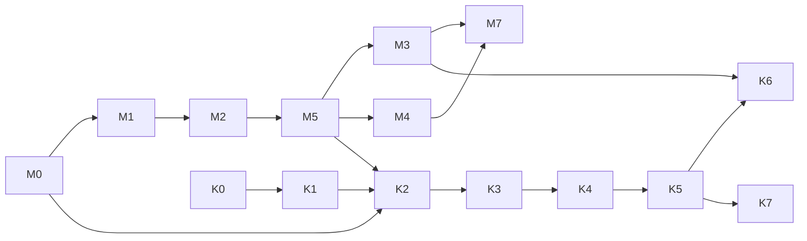

# 碧琪维护 + C.le. 内核接管 · 总览

两份计划合在一起，叫「这次的整体计划」：

- **维护计划** `briefs/maintenance-1120/`：在碧琪仓库里装护栏、理家底，批次 M0–M7（M6 已取消）。
- **内核接管计划** `briefs/cle-core-1120/`：把 OpenClaw 接管成自己的内核 C.le.，批次 K0–K7。

本目录的文件：

| 文件 | 给谁看 | 内容 |
|---|---|---|
| `README.md`（本文件） | 所有人 | 全部批次一览、先后关系、哪些可以同时做 |
| `CONCURRENCY.md` | **每个执行者和验收人开工前必读** | 多个 AI 同时干活的规矩 |
| `ACCEPTANCE.md` | 验收人、用户 | 每一批怎么验收、里程碑、最后的总验收 |
| `PROMPTS.md` | 用户 | 派活和验收的通用提示词，填上批号就能用 |

每一批具体做什么、怎样算过，仍然以两份计划各自的 `PLAN.md` 和 `ACCEPTANCE.md` 为准。本目录只管「怎么一起干、怎么一起验」。

---

## 一、全部批次一览

「独占文件」是这一批要改、而且别的批次同时改就一定会冲突的文件。认领规矩见 `CONCURRENCY.md` 第二节。

| 批 | 一句话 | 前置条件 | 可以同时进行的批 | 独占文件和资源 | 机器 |
|---|---|---|---|---|---|
| **M0** | 测量脚本加棘轮测试 | 无 | K0 | `tools/health/**`、`tests/code-health-ratchet.test.mjs` | 任一 |
| **M1** | 收分支，学习台游戏 v4 进主线 | M0 已合并 | K0、K1 | 远端分支的删除和存档；合并期间**主线冻结**（见 `CONCURRENCY.md` 4.4） | 任一 |
| **M2** | 资源版本号自动生成 | M1 已合并 | K0、K1 | `ui/injections/laolao-head.fragment.html`、懒加载版本号的注入文件、`installer/macos/apply-theme.sh`、`installer/windows/apply-theme.ps1`、`build-win.ps1`、`tools/ui-parity/bundle.py`、`tools/claude-deploy/deploy-work-first.py`、`ui/runtime/index-*.js`、`tests/windows-self-contained.test.cjs` | 任一，Mac 路径要 Mac 补测 |
| **M5** | 截图基线加热点测试 | M2 已合并 | K0、K1 | `tests/visual/**`、新增的热点测试、`scripts/chat-ui-harness/**`、`tools/ui-parity/capture.mjs`、`.github/workflows/ci.yml` | 任一 |
| **M3** | 区域负责表加共用观察器（收窄版） | M5 已合并 | **M4**、K0、K1 | `ui/injections/**`（除 M4 以外没有别的批碰）、`ui/injections/REGIONS.md`、`regions.json` | 任一 |
| **M4** | 拆两个巨无霸文件 | M5 已合并 | **M3**、K0、K1 | `services/mode-architecture/index.mjs` 和拆出来的新模块、`app/windows_desktop.py` 和拆出来的新模块、`超級碧琪.spec`、`.github/workflows/windows-smoke.yml` | Windows（打包验证） |
| **M7** | 地图和规矩 | M3、M4 已合并 | K 系列 | `docs/ARCHITECTURE.md`、`docs/README.md`、`docs/archive/`、根目录 `CLAUDE.md` 和 `AGENTS.md` | 任一 |
| **K0** | 摸底：实际版本、源码试编译、补丁对照表 | 无 | 全部 | `briefs/cle-core-1120/PATCH-MAP.md` 和 K0 记录；仓库外的 OpenClaw 源码目录 | Windows 和 Mac 各做一份 |
| **K1** | 建私有仓库 `cle-core` | K0 已验收，**用户点头** | M 系列 | `cle-core` 仓库本身 | 任一 |
| **K2** | 换成自己编译的内核（原样） | K1 已验收；M0、M5 已合并 | M3、M4（不碰同一批文件时） | `core-manifest.json`、`build-win.ps1`、`desktop/macos/build.sh`、`install.sh`、`install.ps1`、两个 `apply-theme` 脚本 | Windows 和 Mac |
| **K3** | 补丁一个一个搬进源码 | K2 已合并 | 多个 AI 可以各搬不同的补丁（见 `CONCURRENCY.md` 4.5） | 每个补丁对应的源码文件；碧琪这边的 `core-manifest.json` 和补丁顺序**一次只合一个** | 任一，Mac 要补测 |
| **K4** | 显示名字改成 C.le. | K3 已合并 | K6 | 用户可见的文案所在文件（执行时先列清单再认领） | Windows 和 Mac |
| **K5** | 正式切换（发版） | K4 已合并，**用户点头** | 无（发版期间主线冻结） | 发版流程、更新通道 | Windows 和 Mac |
| **K6** | 界面一块一块搬进源码 | M3 已合并、K5 已发布 | K7；不同区域可以由不同 AI 同时做 | 这块区域的注入文件，以及 `cle-core` 里对应的界面源码 | 任一 |
| **K7** | DeepSeek Harness 插件兼容 | K5 已发布 | K6；7-1 和 7-2 可以同时做，7-3 先评估 | 技能安装、连接器相关文件；`cle-core/packages/dsh-compat` | 任一 |

## 二、先后关系

一般情况下最多同时有三路在跑：**M 系列一路**（M3 和 M4 时是两路）、**K 系列一路**、**验收一路**。

## 三、里程碑

| 里程碑 | 包含 | 达成后解锁 |
|---|---|---|
| A 护栏就位 | M0、M5 | K2 可以开始 |
| B 家底干净 | M1 | 后续各批不再被旧分支干扰 |
| C 维护完成 | M2、M3、M4、M7 | 维护计划结束 |
| D 内核等价 | K0、K1、K2 | 补丁搬家可以开始 |
| E 补丁清零 | K3 | Windows 不再依赖 Mac 快照 |
| F 正式切换 | K4、K5 | 用户用上 C.le. 内核 |
| G 插件兼容 | K7 | 能用 DeepSeek Harness 社区的技能、MCP 和工具插件 |
| H 长期 | K6、复发记录 | 没有结束时间 |

每个里程碑怎么验，见 `ACCEPTANCE.md` 第三节。

## 四、现在做到哪了

- 总体：看两份 `PROGRESS.md` 顶部的表格，以及 GitHub 上标题以 `maint(` 或 `core(` 开头的 PR（包括草稿 PR，草稿 PR 就是认领，见 `CONCURRENCY.md` 2.2）。
- 某一批具体做到哪一步：看那一批记录文件最上面的**接力卡**（`briefs/<计划>/progress/<批号>.md`；M0 的在 `briefs/maintenance-1120/PROGRESS.md`）。任何一个 AI 停下来，下一个 AI 都从接力卡接着做，规矩见 `CONCURRENCY.md` 第〇节。
